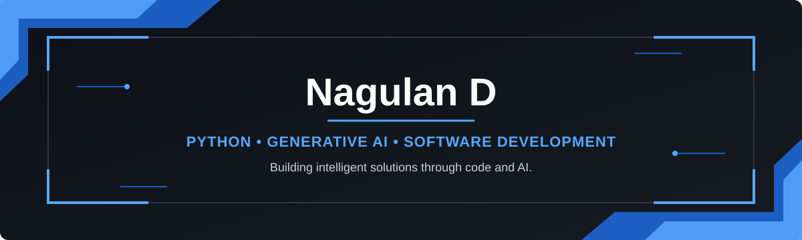

  

## 🛠️ Tech Stack

### 💻 Languages

     

### ⚙️ Frameworks & Libraries

      

### 🤖 AI & Generative AI

            

### 📊 Data Science & ML Libraries

      

### 🗄️ Databases & Vector Stores

     

### 🧰 Tools & DevOps

       

